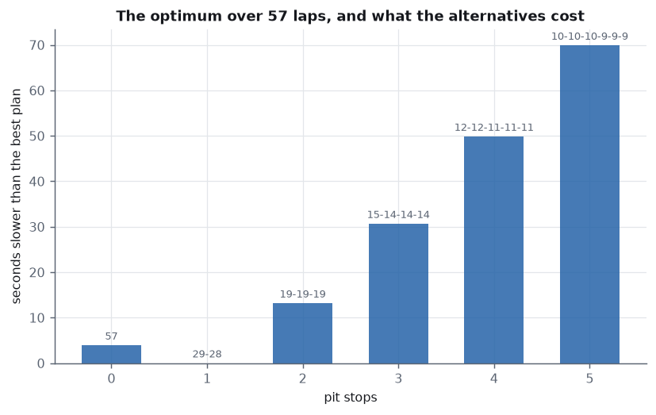
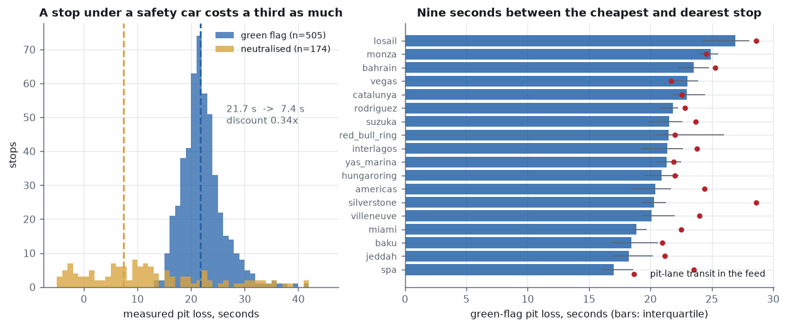
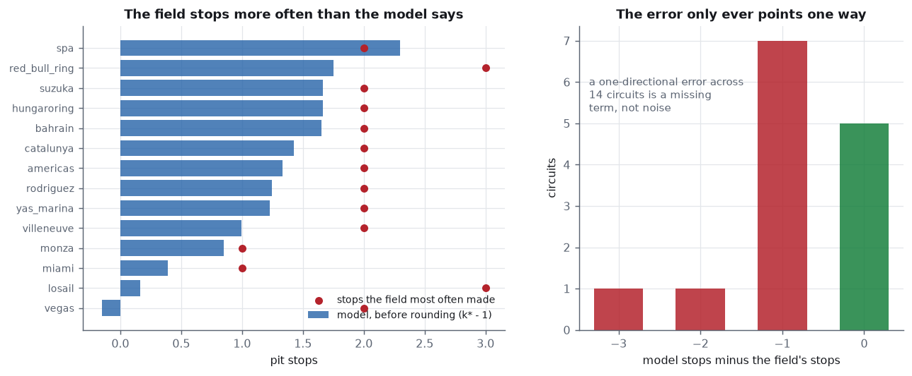
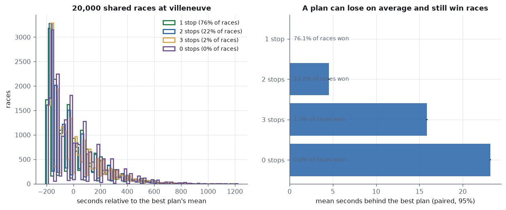
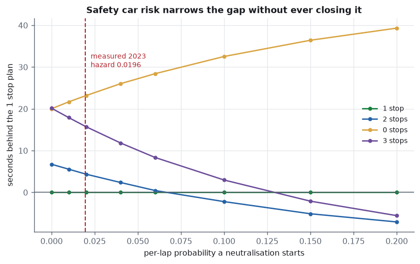
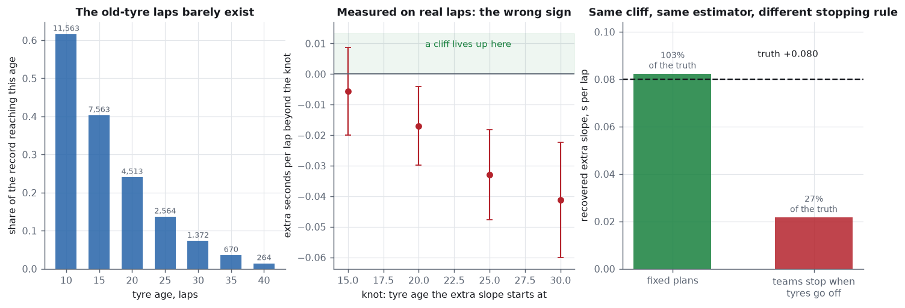
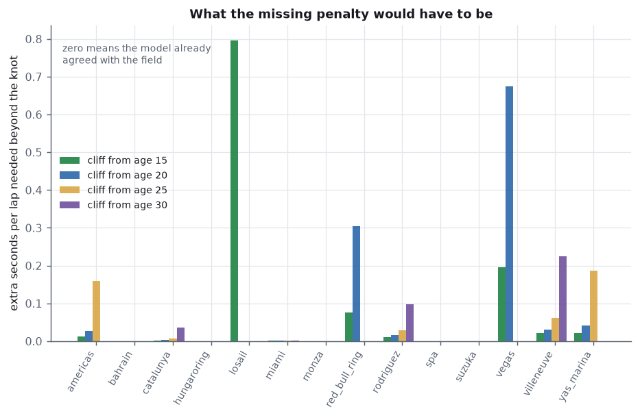
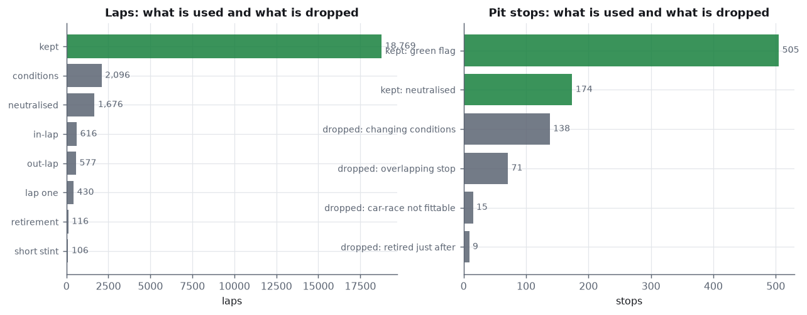

# Race strategy Monte Carlo

Pit strategy solved from 24,386 Formula 1 lap times and 912 pit stops, with
every input measured from the same 2023 season the answer is then tested
against. Nothing is typed in from a reference table.

The optimiser is then checked against what the field actually did — and it
is wrong, in one direction, at nine of fourteen circuits. Most of this
project is about finding out why, and the answer turns out to be a cost
that lap-time data **cannot** measure, for a reason that is itself
measurable.

```
pit loss        21.75 s green flag,  7.43 s under a neutralisation (0.34x)
degradation     +0.0316 s per lap of tyre age   (95%  +0.0256 to +0.0376)
best plan       1 stop at pooled numbers over 57 laps;  k* = 1.537 stints
against 2023    agrees at 5 circuits, too few stops at 9, too many at 0
```

---

## The race is mostly arithmetic, and that part is exact

Race time is a sum of lap times, each one

```
base  +  degradation x (tyre age)  +  fuel x (race lap)
```

Summed over a plan with stints `m₁ … m_k` covering `N` laps, this
decomposes to

```
T  =  N·base  +  fuel·N(N+1)/2  +  (degradation/2)·(Σ m_k² + N)  +  stops·loss
```

The first two terms are the same for *every* plan: all plans run the same
laps and pass the same race laps. Only `Σ m_k²` and the stop count can
change. Three things follow without simulating anything.

**Equal stints are optimal.** `Σ m_k²` is convex, so for a fixed number of
stints the balanced split minimises it. This survives adding a tyre cliff,
because a hinge is still convex — checked by exhaustion over 300
configurations in the tests, not assumed.

**The best stop count has a closed form.** Substituting `N²/k` and
differentiating gives `k* = N·√(d / 2L)`. At the pooled 2023 numbers over
57 laps that is **1.537 stints**, and comparing the integers either side
gives a one-stop race.

**Stint order is irrelevant.** Tyre age restarts each stint and the fuel
term is a sum over race laps that every plan covers identically, so
`30-20-7` and `7-30-20` are the same race time to the last decimal. That
is a property of the model and the sharpest statement of what it leaves
out: **there is no undercut in here.** See [Scope](#what-this-does-not-do).



An exhaustive search over every integer partition of the race distance
finds exactly what the algebra does — agreement to `0.00e+00` seconds. That
is a test, not a hope.

---

## Finding 1 — a pit stop costs 21.75 s, and 7.43 s behind a safety car

The feed records a `duration` for every stop, but in this schema that is
**pit-lane transit time** — entry line to exit line, 18 to 30 seconds. It
is not the pit loss, because some of that time would have been spent
driving anyway. So the cost is measured from lap times instead, which needs
no convention:

```
loss = (in-lap − what that lap should have taken clean)
     + (out-lap − what that lap should have taken clean)
```

The counterfactual is the car's own race: for each car-race, clean laps are
regressed on tyre age and race lap, and the fitted line is evaluated at the
in-lap and the out-lap. A car that stopped has at least two stints, so age
and race lap are separately identified and the prediction is not an
extrapolation along a collinear design.



| | median | IQR | stops |
|---|---|---|---|
| green flag | **21.75 s** | 19.75 – 23.84 | 505 |
| neutralised | **7.43 s** | — | 174 |
| discount | **0.342×** | | |

Per circuit the green-flag loss runs from **Spa 17.02 s** to **Losail
26.90 s**. Those sit in the same band as published pit-lane time-loss
figures, and the ordering matches the qualitative descriptions — Spa is
routinely called one of the shortest pit lanes on the calendar, and
[F1 lists Singapore's 2023 loss as the season's longest at 29.83 s](https://www.formula1.com/en/latest/article/need-to-know-the-most-important-facts-stats-and-trivia-ahead-of-the-2023-singapore.361ZHWFD1aZr8opUZr70yJ).
They are not claimed to agree to the second: a published "pit lane time
loss" and this measurement are not defined identically, and this one also
carries the out-lap tyre warm-up, which happens past the pit exit.

Singapore is absent from the per-circuit table for a reason worth stating:
21 of its 25 stops were taken under a neutralisation, leaving 4 green-flag
stops, below the minimum of 8.

**The 0.342 discount is the only reason this project needs a simulation at
all.** More on that below.

---

## Finding 2 — the model is wrong, and it is wrong in one direction



Fed per-circuit degradation and per-circuit pit loss, the optimiser
recommends:

| | circuits |
|---|---|
| agrees with the field | 5 |
| **too few stops** | **9** |
| too many stops | **0** |
| refused (degradation not positive) | 4 |

Nine errors, all pointing the same way, across fourteen independent races.
Random error lands on both sides. **A one-directional error is a missing
term.**

Four circuits are refused outright rather than ranked, because their
measured degradation is not positive — at Baku, Interlagos, Jeddah and
Silverstone the 2023 laps say tyres improve with age, and no stop count
exploits that. Returning a plan anyway would be the optimiser lending
precision to a number that has none.

### and the input is blunter than the question

Before explaining the gap it is worth saying how much the measurement can
support at all. Re-solving at both ends of each circuit's degradation
confidence interval, **only 3 of the 14 ranked circuits have an interval
narrow enough to pin a stop count** (Monza, Red Bull Ring, Yas Marina).
Even Spa — the steepest, best-determined degradation of the season at
+0.1912 (+0.151 to +0.231) — spans three *and* four stints.

I wrote that check expecting Spa to decide it. It does not, and the test
now records that it does not.

---

## Finding 3 — it is not safety car risk

A neutralisation discounts a stop by two thirds, and only a plan with a
stop left to make can collect that. That makes the value of an extra stop
genuinely stochastic, which is what the Monte Carlo is for.

The neutralisation process is measured, not assumed: **23 periods across 20
dry races**, a per-lap hazard of **0.0196**, mean length **2.91 laps**, and
a neutralised lap running **1.528×** the race's own green baseline. Applied
to the real race distances the process predicts a neutralisation in 68.3%
of races against **65.0% observed**. It over-predicts slightly because real
periods cluster — one race had four — so a constant hazard that matches the
total count spreads them across too many races.



20,000 races at Villeneuve, every plan run through the **same** draws so
the comparison is paired:

| plan | mean | behind best (paired, 95%) | races won |
|---|---|---|---|
| 1 stop `35-35` | 6761.12 | — | **76.1%** |
| 2 stops `24-23-23` | 6765.67 | +4.55 ± 0.12 | 22.2% |
| 3 stops `18-18-17-17` | 6776.98 | +15.86 ± 0.10 | 1.7% |
| 0 stops `70` | 6784.32 | +23.20 ± 0.08 | 0.0% |

The two-stop loses on the mean by 4.5 s and still wins **22% of individual
races**. That gap between "best on average" and "wins most often" is the
entire output a mean cannot give you.



But it does not rescue the model. Sweeping the hazard, an extra stop takes
over at **0.100 — 5.1× the hazard actually measured**. Neutralisation risk
pushes in the right direction and would need the season to be five times
more chaotic than it was to explain the field's behaviour.

> **Why independent lap-time noise is not in that list.** Race time is a
> sum, so zero-mean noise on every lap leaves every plan's mean exactly
> where it was. It widens outcomes without reordering them — tested at
> σ = 0.5, 4 and 12 s, where the ranking never moves. The simulation exists
> for the safety car and for nothing else.

---

## Finding 4 — the missing cost is one these laps cannot measure

The remaining candidate is the one any engineer names first: tyre
performance is not linear in age. A set fades gently and then falls away. A
linear fit through a stint that was *ended before it fell away* measures
the gentle part, which makes long stints look cheap, which recommends too
few stops. Exactly the error observed.



Fitting an extra slope beyond a knot tests it directly. The answer comes
back with the **wrong sign**, significantly:

| knot | extra s/lap beyond it | 95% | p | laps beyond |
|---|---|---|---|---|
| 15 | −0.0056 | −0.0200 to +0.0087 | 0.441 | 6,857 (36.5%) |
| 20 | −0.0170 | −0.0298 to −0.0041 | 0.010 | 4,062 (21.6%) |
| 25 | −0.0330 | −0.0476 to −0.0183 | 0.000 | 2,274 (12.1%) |
| 30 | −0.0412 | −0.0601 to −0.0223 | 0.000 | 1,198 (6.4%) |

Taken at face value: old tyres fade *more slowly*, with p < 0.001.

**That result is unusable, and the reason is the point of the project.**
Teams choose when to stop, and they stop before the tyre goes away. So a
stint only reaches a high age when that particular set happened to be
holding on — which is selection directly on the thing being measured. The
laps that would reveal a cliff are the laps strategy exists to avoid.

### proved rather than asserted

That argument can be tested where the truth is known. Every simulated car
is given the **same** real cliff of +0.0800 s/lap beyond age 20. The two
arms differ *only* in how stints end.

| stints ended by | recovered | 95% | share of truth |
|---|---|---|---|
| a fixed plan | **+0.0823** | +0.0777 to +0.0868 | **103%** |
| teams stopping when tyres go off | **+0.0216** | +0.0157 to +0.0276 | **27%** |

The estimator is sound. The stopping rule is what destroys it. And the
attenuation is monotone in how promptly teams are assumed to react — at a
1.0 s/lap trigger only 16% of the cliff survives, at 3.0 s/lap 53% does.

---

## Finding 5 — how big the missing penalty would have to be

Since the cliff cannot be measured from these laps, the question is
inverted: *what extra penalty would make the field's own choice optimal?*
This is **not** a measurement of the cliff and is not offered as one. It is
a statement of the form *if a cliff is the only thing missing, it is this
big*.



| knot | circuits a cliff can reach | disagreeing | median required | range |
|---|---|---|---|---|
| 15 | 14 | 9 | +0.0213 s/lap | +0.001 to +0.795 |
| 20 | 13 | 8 | **+0.0287 s/lap** | +0.001 to +0.674 |
| 25 | 11 | 6 | +0.0453 s/lap | +0.001 to +0.186 |
| 30 | 9 | 4 | +0.0675 s/lap | +0.002 to +0.225 |

A cliff of +0.029 s/lap beyond age 20 — roughly the size of the pooled
linear degradation itself — reconciles the median disagreeing circuit. That
is a modest, physically unremarkable number, which is what makes the
hypothesis worth taking seriously.

At a handful of circuits it would take an absurd cliff, or none reaches at
all. Those are mostly circuits where the degradation estimate is itself
near zero and uninformative (Losail +0.0225 with an interval running to
−0.0012, Vegas +0.0133 to −0.0102), so the right reading is that the input
is too weak there, not that the tyre fell off a precipice.

---

## Three things that changed during the build

**A safety car stop first came out twice as expensive as a green one.** The
counterfactual was a *green-flag* lap, so the measurement was charging the
stop for the safety car's own slowness. Under a neutralisation the car that
stays out is slow too, so the reference must be slow as well: the car's own
fitted line, scaled by how far the field median for that lap sits above the
race's baseline. The discount went from 1.99× (a premium) to 0.342×. The
inverted version is kept as a test.

**The condition filter was being fed the wrong laps.** `condition_spread`
is defined on racing laps, and I handed it raw ones — pit laps, safety car
laps, lap one and all. Every race's spread inflated and 561 of 912 stops
were thrown away as "changing conditions". Running the cleaning first, with
the condition rule itself disabled, drops the correct 138.

**I expected Spa's interval to decide its stop count.** It does not: +0.151
to +0.231 spans three and four stints. Checking the rest of the season
turned a failed assertion into Finding 2's second half — only 3 of 14
circuits are measured precisely enough to pin a strategy at all. The test
now asserts the truth and says in its own docstring what it was written to
expect.

---

## What this does not do

- **No track position, and therefore no undercut or overcut.** This is a
  single-car time trial. Stint order provably cannot change race time here,
  which is exactly wrong about real racing — stopping before the car ahead
  is a strategy precisely because of where you come out. A large part of
  the remaining gap to the field is very likely this, and this model cannot
  separate it from the cliff.
- **No tyre compounds.** The Ergast schema never recorded them. So the
  regulation requiring two compounds in a dry race is not modelled, and
  the zero-stop plan is shown only as a reference point — it loses to one
  stop on time anyway.
- **No traffic, no weather, no reliability.** Races whose own pace drifts
  too far are excluded whole rather than modelled.
- **One season.** 2023 only. Every number here is that season's.
- **A reactive rule of one line.** A plan brings its next stop forward if a
  neutralisation starts within a window. There is no responding to rivals,
  because there are no rivals.

---

## Fachbegriffe

| English | Deutsch |
|---|---|
| pit stop | der Boxenstopp |
| pit loss / time lost in the pit lane | der Zeitverlust in der Boxengasse |
| pit lane | die Boxengasse |
| in-lap / out-lap | die Einfahrrunde / die Ausfahrrunde |
| stint | der Stint, der Reifenabschnitt |
| tyre age | das Reifenalter |
| tyre degradation | der Reifenabbau, die Reifendegradation |
| tyre cliff | der Reifenabriss, die Abbaukante |
| fuel burn | der Kraftstoffverbrauch |
| track evolution | die Streckenentwicklung |
| safety car | das Safety Car |
| neutralisation | die Neutralisierung |
| hazard rate | die Ausfallrate, die Hazardrate |
| closed form | die geschlossene Form |
| convexity | die Konvexität |
| partition (of an integer) | die Zerlegung |
| exhaustive search | die vollständige Enumeration |
| Monte Carlo simulation | die Monte-Carlo-Simulation |
| common random numbers | gemeinsame Zufallszahlen |
| variance reduction | die Varianzreduktion |
| paired comparison | der paarweise Vergleich |
| confidence interval | das Konfidenzintervall |
| selection bias | der Selektionsfehler, die Stichprobenverzerrung |
| censoring | die Zensierung |
| attenuation bias | die Abschwächungsverzerrung |
| piecewise linear / hinge | stückweise linear / der Knick |
| knot | der Knotenpunkt |
| fixed effects | feste Effekte |
| cluster-robust standard error | clusterrobuster Standardfehler |
| identification | die Identifikation |
| counterfactual | das kontrafaktische Szenario |
| sensitivity analysis | die Sensitivitätsanalyse |
| inverse problem | das inverse Problem |

---

## Layout



```
run.py                   measure everything, solve, validate, report
src/data.py              the Jolpica/Ergast feed, cached per season
src/stints.py            which laps are usable, and why
src/model.py             the within estimator with clustered errors
src/pitloss.py           what a stop costs, green flag and neutralised
src/race.py              the race as an equation; closed forms
src/strategy.py          partition search, refusals, interval solving
src/montecarlo.py        shared-draw simulation, reactive stops
src/cliff.py             the hinge test, the selection proof, the inversion
src/charts.py            eight figures
src/report.py            one self-contained HTML file
tests/test_strategy.py   43 tests
out/                     figures, report.html, _run.txt
```

```bash
pip install -r requirements.txt && python run.py && python -m pytest -q
```

`data.py`, `stints.py` and `model.py` are carried over from the
[stint-degradation](https://github.com/Pratsss24/stint-degradation) project,
which is where the degradation number and the cleaning rules come from.

## Sources

- Lap times, pit stops and results: the [Jolpica](https://api.jolpi.ca/ergast/f1/)
  mirror of the Ergast schema. Unauthenticated and rate limited.
- Ragnar Frisch and Frederick Waugh (1933), and Michael Lovell (1963) —
  the partialling-out result the within estimator rests on.
- Kung-Yee Liang and Scott Zeger (1986) — cluster-robust standard errors.
- James Heckman (1979) — selection on the outcome, which is what Finding 4
  is an instance of.
- [F1's 2023 Singapore preview](https://www.formula1.com/en/latest/article/need-to-know-the-most-important-facts-stats-and-trivia-ahead-of-the-2023-singapore.361ZHWFD1aZr8opUZr70yJ),
  for the published pit-lane time loss used as a sanity check.
